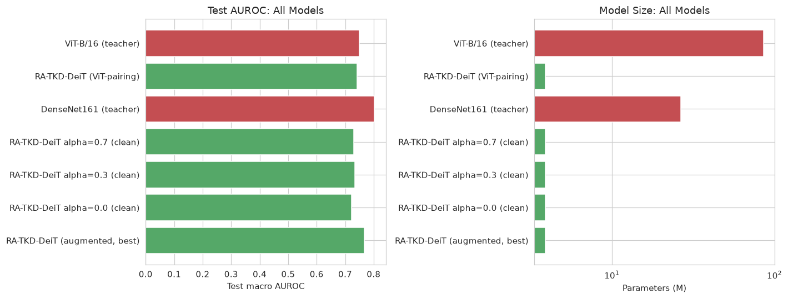
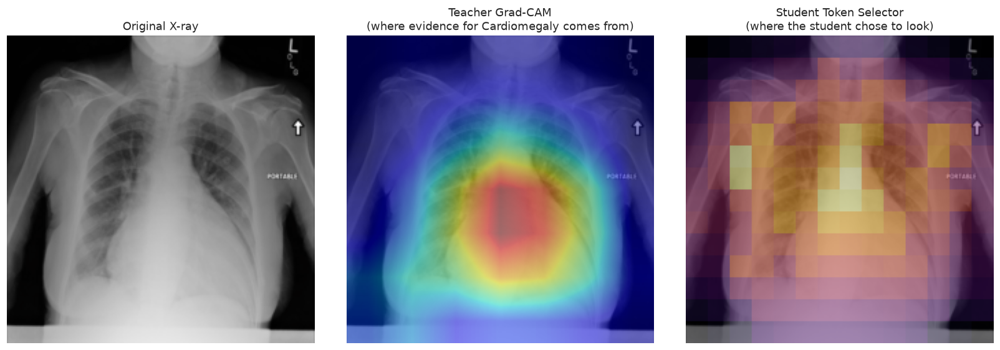

# MSc_AI — RA-TKD: Region-Aware Token Knowledge Distillation for Chest X-Ray Classification

**Author:** Mohammed Shimal Iddin 

## Description

This project trains a lightweight Vision Transformer student
(**RA-TKD-DeiT**) for multi-label chest X-ray pathology classification on
the **NIH ChestX-ray14** dataset (14 pathology classes: Atelectasis,
Cardiomegaly, Effusion, Infiltration, Mass, Nodule, Pneumonia,
Pneumothorax, Consolidation, Edema, Emphysema, Fibrosis,
Pleural_Thickening, Hernia), via knowledge distillation from larger
pretrained teacher networks. The student combines a convolutional stem, a
patch-embedding stage, and a novel **Region-Aware Token Selector** that
blends a learned per-token relevance score with a fixed central thoracic
spatial prior to retain the most informative image tokens (discarding or
summarising the rest) before a DeiT-style transformer encoder.

Two independent teacher/student pipelines are implemented:

| Pipeline | Teacher | Teacher checkpoint | Student training scripts |
|---|---|---|---|
| DenseNet-based (primary) | DenseNet161 | `densenet_teacher_best.pth` | `train_student_densenet*.py` (6 variants) |
| ViT-based (DDP) | ViT | `vit_teacher_best_auc.pth` | `train_student.py` |

## Visuals

### Test mAUROC across all models



Comparison of test-set macro AUROC across the DenseNet161 teacher and all
RA-TKD-DeiT student configurations (clean baseline, alpha = 0.0001 / 0.3 /
0.7, augmented, and full-fix v1). This shows how closely the compact
student approaches teacher performance while using a fraction of the
parameters and FLOPs (see `report_model_complexity.py`).

### Original image vs. teacher Grad-CAM vs. student token selector



Side-by-side comparison of the raw chest X-ray, the DenseNet161 teacher's
Grad-CAM attention (from the final dense block, `denseblock4`), and the
RA-TKD student's learned region-aware token-selection scores (from
`RegionAwareTokenSelector`, upsampled from the 14x14 patch grid). This
demonstrates that the lightweight student attends to anatomically similar
regions as the much larger teacher despite retaining only a subset of
image tokens.

## Installation

### Requirements
- Python 3.9+
- PyTorch (with CUDA support recommended for training)
- `torchvision`
- `scikit-learn`
- `pandas`, `numpy`
- `thop` (only required for `report_model_complexity.py`)
- The **NIH ChestX-ray14** dataset (images + label CSVs)


Download the NIH ChestX-ray14 dataset and update the dataset paths in
`config.py` (`PROJECT_DATA_DIR`, `TRAIN_CSV`, `VAL_CSV`, `TEST_CSV`,
`IMAGE_ROOT`) to point at your local copy of the images and label CSVs
before running any script.

## Usage

### 1. Prepare the data splits (one-time)
```bash
python check_patient_leakage.py
python fix_train_val_leakage.py
python rebalance_train_val_split.py
```
This removes patient-level overlap between train/val/test and rebalances
the small post-leakage-fix validation set to ~90/10 by patient, without
ever modifying `test.csv`.

### 2. Train a teacher
```bash
python train_teacher_densenet.py          # DenseNet161 teacher (single GPU)
torchrun --nproc_per_node=<N> train_teacher.py   # ViT teacher (multi-GPU, DDP)
```

### 3. Train a student
```bash
python train_student_densenet.py               # clean baseline (alpha = 0.3 fixed)
python train_student_densenet_alpha00.py        # alpha = 0.0001
python train_student_densenet_alpha03.py        # alpha = 0.3
python train_student_densenet_alpha07.py        # alpha = 0.7
python train_student_densenet_augmented.py      # with data augmentation
python train_student_densenet_fullfix_v1.py     # + Grad-CAM attention + class weighting
torchrun --nproc_per_node=<N> train_student.py  # ViT-teacher DDP pipeline
```

### 4. Evaluate a checkpoint
```bash
python eval_teacher_densenet.py
python eval_student_densenet_alpha07.py
# ...corresponding eval_*.py for any checkpoint above
```

### 5. Report model complexity
```bash
python report_model_complexity.py
```
Writes parameter counts (M) and FLOPs (GFLOPs) for the teacher and student
to `model_complexity_report.csv`.

### Example output
```
Epoch 1/100 | Train: 0.4213 | Val: 0.3897 | Val mAUROC: 0.6842
Saved best student checkpoint (clean baseline), mAUROC=0.6842
...
Epoch 47/100 | Train: 0.2011 | Val: 0.2255 | Val mAUROC: 0.7330
Early stopping at epoch 47 (no improvement for 10 epochs). Best mAUROC=0.7330
```

## Architecture

### Student: RA-TKD-DeiT
- **ConvStem** — two stride-2 convolutions reduce spatial resolution 4x before patching.
- **PatchEmbed** — a strided convolution converts feature maps into a 14x14 grid of patch tokens (embed_dim=192).
- **RegionAwareTokenSelector** — scores each token as `alpha * spatial_prior + (1 - alpha) * learned_relevance`, retains the top-`keep_tokens` (default 98), and mean-pools the remaining tokens into `summary_tokens` (default 14) contextual summaries. `alpha` is a learnable, sigmoid-bounded parameter.
- **TransformerBlock x8** — pre-norm DeiT-style encoder blocks (3 heads, GELU MLP, ratio 4.0).
- **AttentionPooling** — learns a softmax-weighted summary over the final image tokens.
- **Head** — fuses the class token with the attention-pooled token representation and predicts 14 logits.

### Alpha ablation variants

| File | alpha_init | Best test mAUROC (clean) |
|---|---|---|
| `novel_model_alpha00.py` | 0.0001 (near-fully learned) | 0.7217 |
| `novel_model_alpha03.py` | 0.3 | 0.7330 |
| `novel_model_alpha07.py` | 0.7 (mostly spatial prior) | 0.7295 (clean) / 0.7672 (augmented) |
| `novel_model.py` (base) | 0.3, hardcoded, not configurable | used by augmented / fullfix / DDP scripts |

### Teachers
- `model_teacher_densenet.py` — `DenseNet161TeacherWithFeatures`, exposes intermediate ("mid", 384-dim) and final (2208-dim) features for feature distillation.
- `model_teacher.py` — `ViTTeacherWithFeatures`, exposes 768-dim features for the DDP pipeline.

## Data Pipeline & Leakage Fixes

- `check_patient_leakage.py` — audits train/val/test CSVs for patient-ID overlap (patient ID derived from the `image_name` prefix, as used across the NIH ChestX-ray14 filename convention).
- `fix_train_val_leakage.py` — removes any patient whose images appear in both train and val.
- `rebalance_train_val_split.py` — re-pools and re-splits train+val ~90/10 by patient after the leakage fix left val too small (1,705 images / 1,664 patients out of 112,120 total) for reliable rare-class AUROC; backs up pre-rebalance CSVs and re-verifies zero cross-split patient overlap.
- `dataset.py` — `ChestXrayDataset` loads images and multi-label targets from the CSVs.

## Training Scripts Reference

| Script | Teacher | Augmentation | Loss module | Selection metric | Checkpoint |
|---|---|---|---|---|---|
| `train_teacher_densenet.py` | — | none | `FocalBCELoss` (gamma=2.0) | val loss | `densenet_teacher_best.pth` |
| `train_teacher.py` (DDP) | — | none | `BCEWithLogitsLoss` | val mAUROC | `vit_teacher_best_auc.pth` |
| `train_student_densenet.py` | DenseNet161 | none | `losses.MultiLabelKDLoss` + `FeatureDistillationLoss` | val mAUROC | `ratkd_deit_densenet_clean_baseline.pth` |
| `train_student_densenet_alpha00.py` | DenseNet161 | none | same as above | val mAUROC | `ratkd_deit_densenet_alpha00.pth` |
| `train_student_densenet_alpha03.py` | DenseNet161 | none | same as above | val mAUROC | `ratkd_deit_densenet_alpha03.pth` |
| `train_student_densenet_alpha07.py` | DenseNet161 | none | same as above | val mAUROC | `ratkd_deit_densenet_alpha07.pth` |
| `train_student_densenet_augmented.py` | DenseNet161 | rotation, resized crop, colour jitter | same as above | val mAUROC | `ratkd_deit_densenet_augmented.pth` |
| `train_student_densenet_fullfix_v1.py` | DenseNet161 | none | `novel_losses.MultiLabelKDLoss` (pos-weighted, Grad-CAM attention term) + `FeatureDistillationLoss` | val mAUROC | `ratkd_deit_densenet_fullfix_v1.pth` |
| `train_student.py` (DDP) | ViT | none | `novel_losses.MultiLabelKDLoss` + `FeatureDistillationLoss` (single teacher_dim) | val mAUROC (world-averaged) | `ratkd_deit_best_auc.pth` |

## Roadmap

- Reconcile `novel_model.py` with the alpha-ablation variants so `alpha_init` is a configurable constructor argument everywhere.
- Standardise `MultiLabelKDLoss` call signatures between `losses.py` and `novel_losses.py`.
- Add AUROC tracking to `train_teacher_densenet.py` alongside its validation-loss-based checkpointing.
- Add further visualisations (per-class AUROC breakdown, token-selection heatmaps on harder classes such as Nodule/Pneumonia, training curves).


## Contributing

This is an individual MSc research project; external contributions are not
currently being accepted. If you would like to build on this work, please
fork the repository. When making changes:

1. Keep the data-leakage checks (`check_patient_leakage.py`) passing after any change to the train/val/test split logic.
2. Re-run the relevant `eval_*.py` script after any change to a training script or model file, to confirm checkpoints remain loadable and comparable.
3. Note any change to a loss or model constructor signature in the pull/merge request description.

## Authors and Acknowledgment

- **Mohammed Shimal Iddin** — author and implementer.
- **Dr. Muhammad Fahim** — project supervisor.
- Queen's University Belfast, School of EEECS — MSc Artificial Intelligence programme.
- NIH Clinical Center — for the ChestX-ray14 dataset.
